# Dompetku

Aplikasi pencatat keuangan sederhana untuk mencatat pemasukan dan pengeluaran harian,
agar kondisi dompet mudah dipantau. Dibuat sebagai Project UTS Pemrograman Mobile (Flutter).

- **Nama:** Gabriel Pranata Sembiring
- **NIM:** 2415051086
- **Kelas:** PTI-5C
- **Tema:** Pencatat keuangan pribadi
- **APK:** [UTS_2415051086_GabrielPranataSembiring.apk](https://github.com/ellzwkwk/UTS_2415051086_GabrielPranataSembiring/releases/download/v1.0.0/UTS_2415051086_GabrielPranataSembiring.apk)

## Fitur

- Ringkasan keuangan: saldo awal bulan, pemasukan dan pengeluaran bulan ini, total saldo,
  dan saldo per akun (Tunai, Bank, E-wallet). Semua angka dihitung dari data transaksi.
- Riwayat transaksi dengan pencarian (judul, kategori, akun, catatan), filter jenis dan
  periode, serta pull-to-refresh.
- Tambah, ubah, dan hapus transaksi. Hapus memakai dialog konfirmasi, form memakai validasi,
  dan tombol simpan dikunci selama proses berjalan.
- Kurs mata uang dari REST API dan **konversi saldo** ke USD, EUR, GBP, JPY, dan SGD
  (fitur tambahan).
- Mode terang, gelap, atau ikuti sistem. Pilihan disimpan di perangkat.
- Tata letak responsif dengan tiga kondisi (compact, medium, expanded), serta
  `NavigationBar` dan `NavigationRail`.
- State loading, kosong, dan error dengan tombol Coba lagi, serta layar pengganti saat
  aplikasi gagal terhubung ke database.

## Tech Stack

| Komponen | Yang dipakai |
|---|---|
| Framework | Flutter (Dart), Material 3 |
| State management | `provider` (`ChangeNotifier`) |
| REST API | Frankfurter, lewat paket `http` |
| Backend dan database | Supabase (PostgreSQL), lewat `supabase_flutter` |
| Penyimpanan lokal | `shared_preferences` (pilihan tema) |
| Font | Figtree (dibundel, lisensi OFL) |

## REST API yang Digunakan

**Frankfurter** (kurs referensi Bank Sentral Eropa), tanpa API key.

```
GET https://api.frankfurter.dev/v1/latest?base=USD&symbols=IDR,EUR,SGD,JPY,GBP
```

```json
{"amount":1.0,"base":"USD","date":"2026-10-30","rates":{"EUR":0.89509,"GBP":0.74633,"IDR":18148,"JPY":157.25,"SGD":1.2784}}
```

Respons diubah menjadi model `ExchangeRates` dan dipakai di layar Kurs serta konversi saldo.

## Backend dan Database

Data transaksi disimpan di **Supabase (PostgreSQL)**, tabel `transactions`. Definisi tabel,
data awal, dan kebijakan akses ada di [`supabase/schema.sql`](supabase/schema.sql).

| Kolom | Tipe | Keterangan |
|---|---|---|
| id | bigint identity | Primary key |
| student_id | text | NIM pemilik data |
| title | text | Judul transaksi |
| amount | bigint | Nominal rupiah, harus lebih dari 0 |
| type | text | `income` atau `expense` |
| category | text | Kategori |
| account | text | `Tunai`, `Bank`, atau `E-wallet` |
| note | text | Catatan |
| trx_date | date | Tanggal transaksi |
| created_at | timestamptz | Diisi otomatis |

Keempat operasi CRUD (Create, Read, Update, Delete) berjalan pada tabel ini.

## Arsitektur

```
Screen / Widget  ->  Provider  ->  Repository  ->  DataSource (kontrak)
                                                      |-- SupabaseTransactionDataSource
                                                      |-- SampleTransactionDataSource (untuk tes)
```

Provider hanya berbicara dengan repository, dan layar tidak memanggil Supabase atau `http`
secara langsung. Sumber data dapat ditukar dengan mengubah satu baris di `lib/main.dart`.

```
lib/
├── main.dart
├── config/         konstanta dan konfigurasi Supabase
├── models/         Transaction, TransactionFilter, ExchangeRates
├── services/       akses data: Supabase, REST API, penyimpanan tema
├── repositories/   perantara provider dan service
├── providers/      TransactionProvider, ExchangeRateProvider, ThemeProvider
├── screens/        Beranda, Riwayat, Detail, Form, Kurs, Profil, AppShell
├── widgets/        komponen UI yang dipakai ulang
├── theme/          tema terang dan gelap, token warna
└── utils/          format, validasi, breakpoint, penerjemah error
```

## Responsif

| Lebar konten | Kondisi | Riwayat | Navigasi |
|---|---|---|---|
| kurang dari 600 | compact | Daftar satu kolom | `NavigationBar` |
| 600 sampai 839 | medium | Grid dua kolom | `NavigationBar` |
| 840 atau lebih | expanded | Tabel buku kas dan panel akun | `NavigationRail` |

## Penanganan Error

Validasi form, kegagalan jaringan atau API, dan penolakan database ditangani dan diuji
secara sengaja. Ringkasannya ada di [`docs/error-handling.md`](docs/error-handling.md).

## Screenshot

| Beranda (terang) | Beranda (gelap) | Riwayat |
|---|---|---|
| 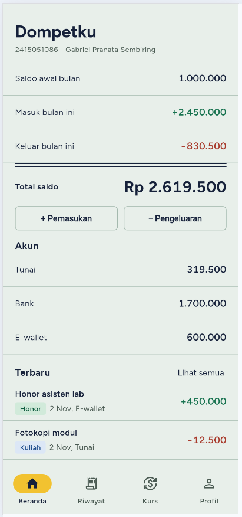 | 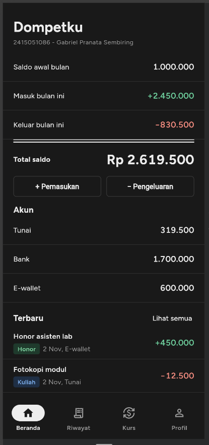 | 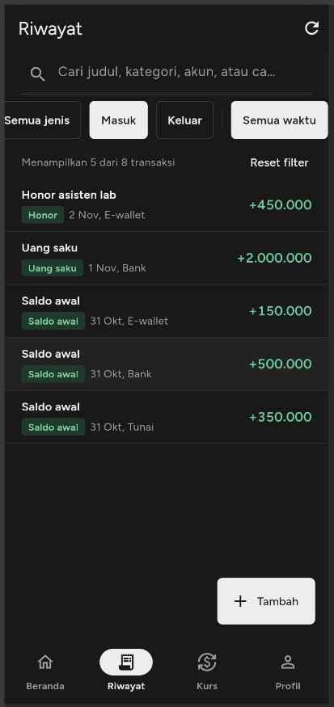 |

| Detail | Tambah | Edit |
|---|---|---|
| 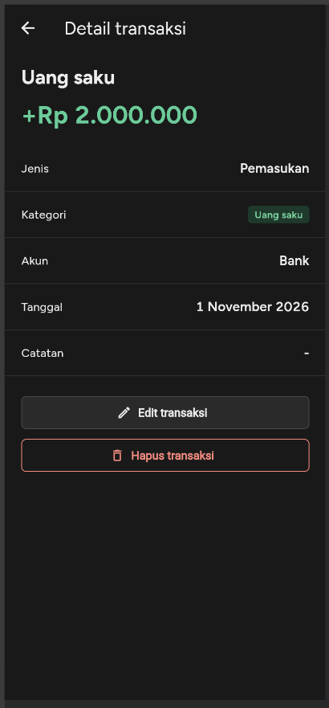 | 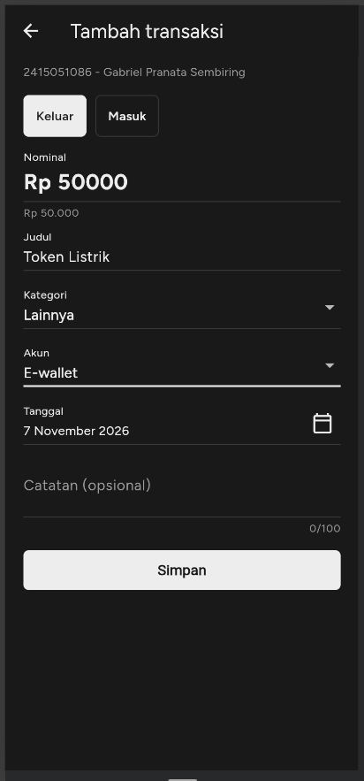 | 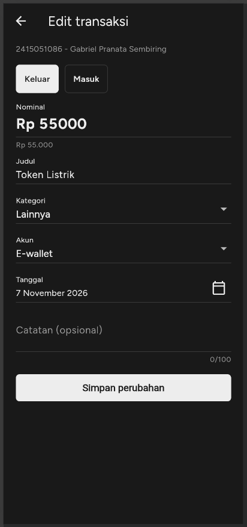 |

| Hapus | Kurs (data API) | Profil |
|---|---|---|
| 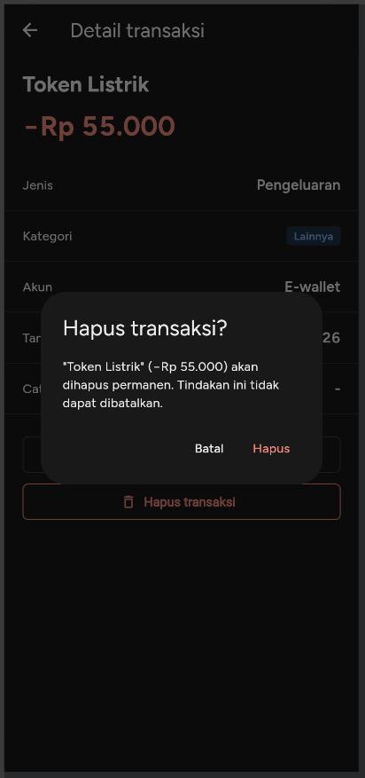 | 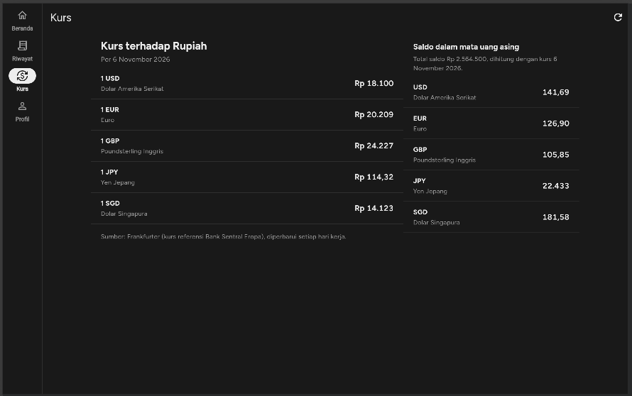 | 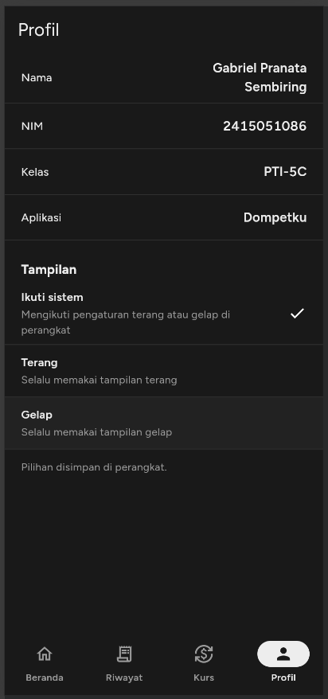 |

**Layar lebar**

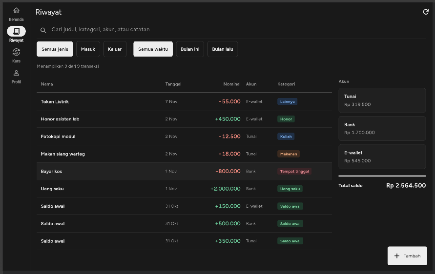
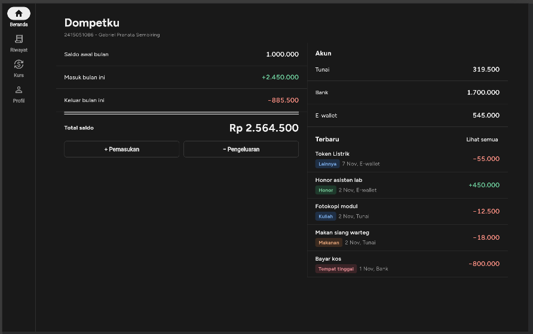

**Data database (Supabase)**

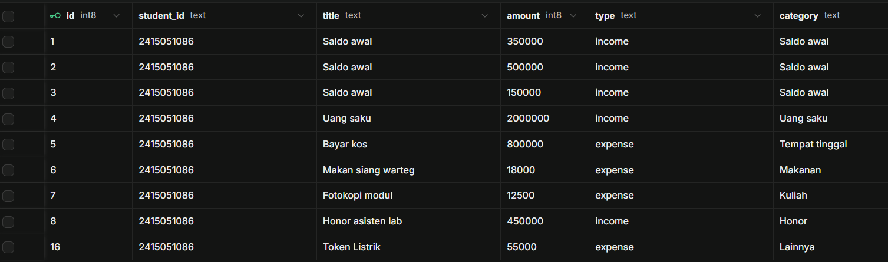

## Cara Menjalankan

Prasyarat: Flutter SDK, dan akun Supabase kalau ingin memakai database sendiri.

1. Ambil dependensi:

   ```bash
   flutter pub get
   ```

2. Siapkan database: buka **SQL Editor** di project Supabase, lalu jalankan isi
   `supabase/schema.sql` untuk membuat tabel, data awal, dan kebijakan akses.

3. Isi `lib/config/supabase_config.dart` dengan Project URL dan key **publishable** milik
   project Anda. Repository ini sudah berisi konfigurasi project demo.

4. Jalankan:

   ```bash
   flutter run
   ```

   Untuk menguji layar lebar: `flutter run -d chrome`.

5. Tes dan APK:

   ```bash
   flutter test
   flutter build apk --release
   ```

## Keamanan

- Aplikasi hanya memakai Project URL dan key **publishable**. Key `secret` atau
  `service_role`, password database, dan keystore tidak digunakan dan tidak ada di repository.
- Kebijakan RLS pada `schema.sql` bersifat permisif dan **hanya untuk praktikum**. Pada aplikasi
  produksi, kebijakan harus mensyaratkan login dan memeriksa kepemilikan data.
- Validasi di UI bukan pengganti validasi di backend. Constraint `check` pada tabel tetap
  menjadi lapisan terakhir.

## Pengembangan Lanjutan

Login pengguna dengan RLS per pengguna, anggaran per kategori, grafik pengeluaran,
transfer antar akun, dan ekspor data.

## Atribusi dan Lisensi

- Gaya visual terinspirasi dari template Notion "Minimal Money Manager" (mode gelap) dan
  konsep buku kas (mode terang).
- Data kurs: [Frankfurter](https://frankfurter.dev).
- Font Figtree berlisensi SIL Open Font License, lihat `assets/fonts/OFL.txt`.